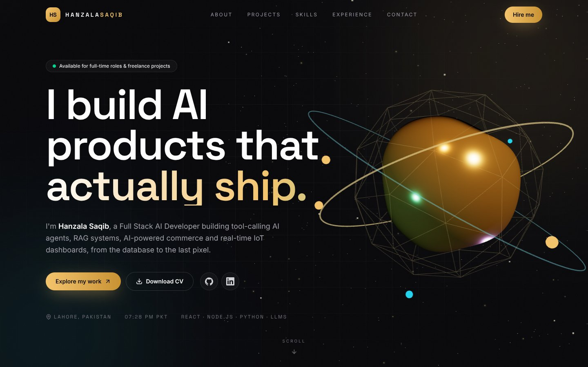
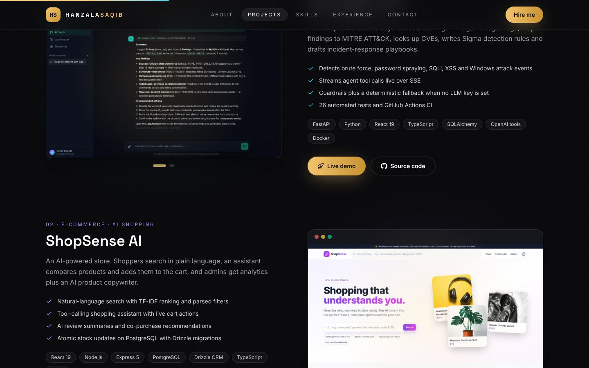

# Hanzala Saqib — 3D Developer Portfolio

**Live site: https://hanzalasqb.github.io/**

A 3D animated portfolio for a Full Stack AI Developer. It features a real-time WebGL hero scene, 3D tilt cards, scroll-driven motion and every project with its live demo and source code.



## ✨ Features

- 🌐 **Real-time 3D hero** (Three.js + React Three Fiber): a liquid-metal core, wireframe shell, orbit rings, satellites and a particle field that follow the cursor and the scroll
- 🃏 **3D tilt cards** with a light sheen for projects, skills and the portrait
- 🎬 **Motion**: staggered headline reveal, scroll progress bar, animated counters, a timeline that draws itself and a cursor glow
- 🗂️ **Projects** with category filters (AI, E-commerce, IoT, Web), screenshot galleries, live demo and source links
- ⚡ **Performance**: the 3D scene is lazy-loaded and pauses when it scrolls out of view; images are WebP
- ♿ Respects `prefers-reduced-motion`, keyboard friendly, semantic sections and SEO meta tags



## 🧰 Tech stack

React 19 · TypeScript · Vite · Tailwind CSS v4 · Three.js · React Three Fiber · Drei · Motion · Lucide

## 🚀 Run locally

```bash
npm install
npm run dev      # http://localhost:5173
npm run build    # production build in dist/
```

Content (projects, skills, experience) lives in [`src/data/content.ts`](src/data/content.ts), so updating the portfolio is a one-file change. Every push to `main` deploys to GitHub Pages through GitHub Actions.

## 📬 Contact

[LinkedIn](https://www.linkedin.com/in/hanzalasaqib) · [GitHub](https://github.com/hanzalasqb) · hanzala7824@gmail.com
